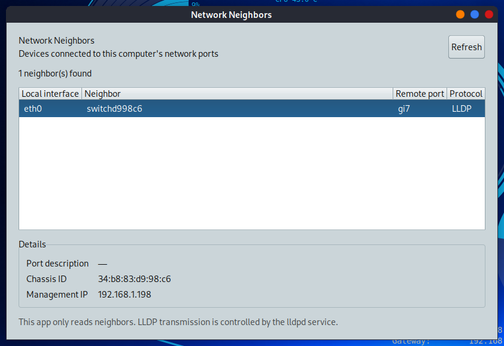

# SysLinuxOS Network Neighbors

Graphical viewer for the network device directly connected to each of this computer's interfaces. It shows the local interface, device name, remote port, advertised port VLAN ID (PVID), protocol and available LLDP details. The app reads `lldpcli`; it does not change network settings.

The interface follows the desktop language in English, Italian, French, German and Spanish.



## Install

Requires SysLinuxOS 13 or Debian 13. The package pulls in `lldpd`, GTK 3 and polkit automatically.

**Option 1 - APT repository (recommended, receives updates).** Add the SysLinuxOS-Tools repository once:

```bash
curl -fsSL https://fconidi.github.io/SysLinuxOS-Tools/client/install-repo.sh | sudo bash
```

Then install the app:

```bash
sudo apt install syslinuxos-network-neighbors
```

**Option 2 - Debian package.** Download `syslinuxos-network-neighbors_0.1.3_all.deb` from the [latest release](https://github.com/fconidi/syslinuxos-network-neighbors/releases/latest) and install it from the folder where you saved it:

```bash
sudo apt install ./syslinuxos-network-neighbors_0.1.3_all.deb
```

After installation open **SysLinuxOS Network Neighbors** from the **Networking** or **SysLinuxOS Tools** menu, or run `syslinuxos-network-neighbors` in a terminal.

## About lldpd

Installing the package also installs and may start the `lldpd` service, which announces this computer to the switch. To receive LLDP without announcing the computer, set `DAEMON_ARGS="-r"` in `/etc/default/lldpd` and restart the service:

```bash
sudo systemctl restart lldpd
```

The package does not change the daemon configuration. If the daemon is unavailable, the window shows a status message. If access to the `lldpd` control socket is restricted, the app asks for desktop authorization and runs a helper that performs only the fixed read-only neighbor query. Consult your network policy before enabling LLDP.

## Use

Select a row for details and use **Refresh** to read the current neighbor list. The PVID appears only when the switch announces it through LLDP; it does not describe every tagged VLAN allowed on the port. An empty list can mean that the connected switch does not send LLDP, the cable is disconnected, or no announcement has arrived yet. The app shows directly connected devices; it does not map the whole network.

## Build

To build the package from source, run `./build-deb.sh OUTPUT_DIRECTORY`.

Copyright 2026 Franco Conidi. Licensed under GPL-3.0-only.
